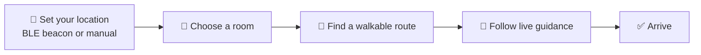
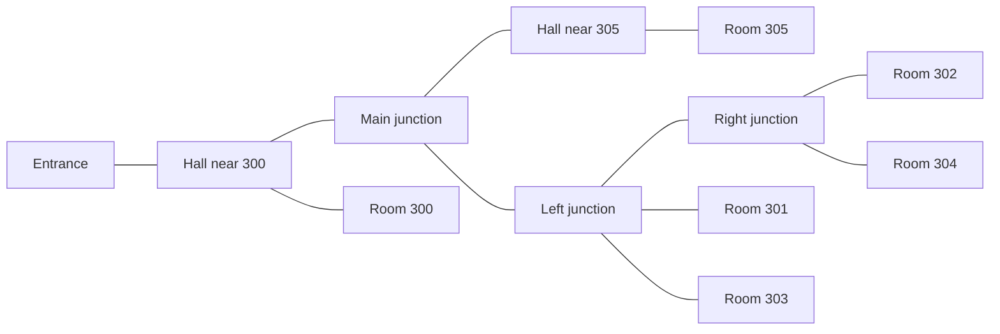
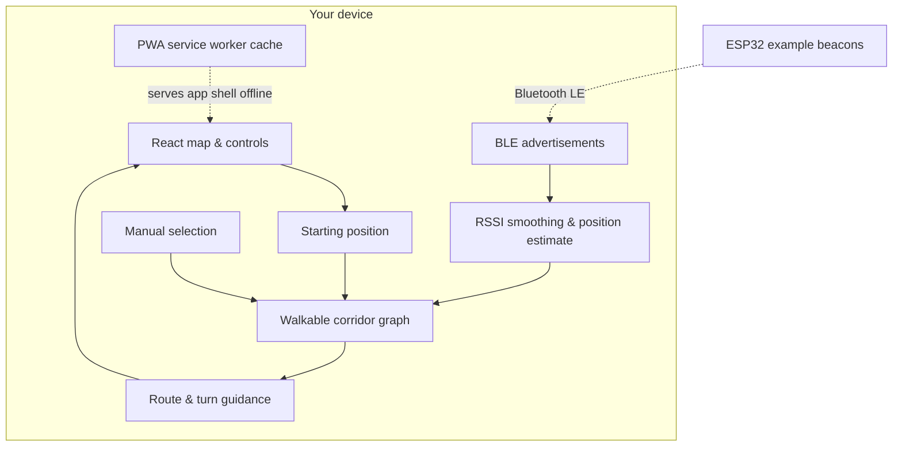

<div align="center">
  
  <h1>Indoor Navigation</h1>
  <p><strong>Find the room. Follow the route. Keep moving.</strong></p>
  <p>A BLE-assisted indoor wayfinding prototype with an interactive floor map, live route guidance, and an installable offline-ready web app.</p>
  <p>
    <a href="#-get-started">Get started</a> ·
    <a href="#-explore-the-map">Explore the map</a> ·
    <a href="#-ble-beacons">Set up beacons</a> ·
    <a href="#-build-and-deploy">Build &amp; deploy</a>
  </p>
</div>

<p align="center">
  
  
  
  
</p>

> **Prototype scope** · The live app currently maps one floor and six rooms (**No. 300–305**). BLE positioning estimates location from radio signal strength; it is not precision positioning.

## ✨ At a glance

| 🗺️ Interactive map | 📡 BLE + manual location | 🧭 Live wayfinding | 📲 Installable PWA |
| --- | --- | --- | --- |
| Select a room or tap a point on the floor plan. | Start with a beacon or set your position yourself. | Get a route, turn cues, and distance/time estimates. | Cache the app shell and use it offline after the first load. |

### The navigation loop



## 🗺️ Explore the map

The current floor connects the entrance to a central corridor, two junctions, and six room doorways. The diagram shows the navigation graph—not a scale drawing.



Routes use a connected graph of corridor junctions and doorways. The app can update the route from the selected or estimated position and show turn and destination-side guidance. Current mapped destinations: **300 · 301 · 302 · 303 · 304 · 305**.

## 🚀 Get started

### Requirements

- **Node.js:** 20.19+ or 22.12+
- **npm**
- A modern browser; **Chrome or Edge** is needed for Web Bluetooth
- For BLE: a Bluetooth-capable device and a secure context (**HTTPS** or `localhost`)

### Run locally

```bash
cd BLE_Navigation_With_Map
npm install
npm run dev
```

Open the local address printed by Vite. You can try the map and routing without any beacon hardware.

### Handy commands

Run commands from `BLE_Navigation_With_Map/`.

| Command | Result |
| --- | --- |
| `npm run dev` | Start the development server |
| `npm run build` | Create the production app and service worker in `dist/` |
| `npm run preview` | Preview the production build |
| `npm run icons` | Regenerate PWA icons |

## 📡 BLE beacons

Two Arduino sketches demonstrate room beacons:

| Sketch | Advertised name | Example destination |
| --- | --- | --- |
| [`beacon_1.ino`](BLE_Becon/beacon_1/beacon_1.ino) | `No. 300` | Room 300 |
| [`beacon_2.ino`](BLE_Becon/beacon_2/beacon_2.ino) | `No. 305` | Room 305 |

Both use the same BLE service UUID:

```text
12345678-1234-1234-1234-1234567890ab
```

### Bring up a beacon

1. Open a sketch in Arduino IDE with an ESP32 board package that provides `BLEDevice.h` and `BLEServer.h`.
2. Select the compatible board and port, then upload the sketch.
3. Power on the board and grant Bluetooth permission in Chrome or Edge when prompted by the app.
4. Choose the room as your destination and use the beacon controls to connect or scan.

To represent another room, change the advertised name to a mapped room name (**No. 300–305**) and keep the service UUID aligned with the app. Aliases `a01` and `b01` are also configured. Beacon placement and signal calibration are building-specific.

<details>
  <summary><strong>BLE compatibility &amp; accuracy notes</strong></summary>

  - Web Bluetooth works in supported Chromium-based browsers such as Chrome and Edge; **iOS Safari does not support Web Bluetooth**.
  - Bluetooth access requires HTTPS, except on `localhost`.
  - RSSI changes with walls, people, device orientation, and beacon placement. Treat the displayed location and distance as estimates.
  - The example beacons broadcast a room identity and service UUID; they do not contain surveyed coordinates or guarantee room-level accuracy.
  - Manual starting-location selection remains available for demos and testing without BLE hardware.
</details>

## ⚙️ How the pieces fit together



The map, routing, and navigation logic run in the browser; this project does not require a separate navigation backend.

## 📲 Build and deploy

Build and test the production PWA locally:

```bash
cd BLE_Navigation_With_Map
npm run build
npm run preview
```

Open the preview once so the app assets can be cached, then test reload with the browser set to offline. To deploy, publish the contents of `BLE_Navigation_With_Map/dist/` to a static **HTTPS** host.

> **Hosting under a subpath?** The current Vite and PWA configuration expects the domain root (`/`). Update the Vite `base` setting and PWA manifest URLs in [`vite.config.js`](BLE_Navigation_With_Map/vite.config.js) for a subpath deployment.

## 🧩 Project layout

```text
BLE_Indoor_Navigation/
├── BLE_Becon/                       # Arduino BLE advertiser sketches
│   ├── beacon_1/beacon_1.ino         # Example: No. 300
│   └── beacon_2/beacon_2.ino         # Example: No. 305
├── BLE_Navigation_With_Map/          # React + Vite PWA
│   ├── public/icons/                 # App and install icons
│   ├── src/
│   │   ├── components/ProjectGuide.jsx
│   │   ├── pwa/                      # Install and update controls
│   │   ├── utils/indoorNavigation.js # Position and route calculations
│   │   └── App.jsx                   # Map, room data, and app behavior
│   └── vite.config.js                # Vite and service-worker configuration
├── indoor_nav_start_change.html      # Standalone HTML project artifact
├── .gitignore
└── README.md
```

## 🛠️ Stack

| Area | Technology |
| --- | --- |
| User interface | React 19 |
| Development and build | Vite 7 |
| Location input | Web Bluetooth LE or manual selection |
| Routing | In-browser walkable-graph pathfinding |
| Offline support | PWA service worker and Workbox |
| Beacon examples | Arduino sketches using ESP32 BLE APIs |

## 📌 Project notes

- The main live map and room data are in [`App.jsx`](BLE_Navigation_With_Map/src/App.jsx).
- Shared route and positioning calculations are in [`indoorNavigation.js`](BLE_Navigation_With_Map/src/utils/indoorNavigation.js).
- The project currently defines no automated test script; `npm run build` is the available production-build check.

## ©️ Copyright & License

Copyright © 2026 NavSense Project (Faculty of Technology, Rajarata University of Sri Lanka) & Contributors.

Licensed under the Apache License, Version 2.0. See [`LICENSE`](LICENSE) for the full terms and conditions.
